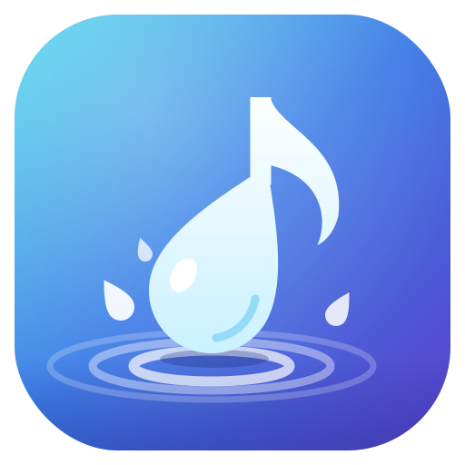

<p align="center">
  
</p>

<h1 align="center">Zuqongsoft Music</h1>

<p align="center">
  A Material 3 desktop music player for your own library, with a studio-grade audio engine,<br>
  DJ crossfades, synced lyrics, karaoke and listening stats. Built with PySide6 and mpv.
</p>

---

## Highlights

- **DJ mode**: real crossfades between songs, silent intros and outros skipped, smooth fades on play, pause and skip
- **Studio EQ**: parametric equalizer with AutoEq headphone correction, A/B comparison, live spectrum and loudness meters
- **Synced lyrics and karaoke**: lyrics that follow the song, a lyrics editor with tap-to-sync, vocal reduction and key change
- **Song Radio**: endless playlists of songs that fit, learned from your own listening
- **Full-screen Now Playing**: big artwork, moving colours from the cover, lyrics and spectrum
- **Your year in music**: plays, top songs, artists and albums, smart playlists
- **Theme from album art**: the whole app recolours from the cover of each song

---

## Features

### Library

- Background, incremental scanning of your music folders (MP3, FLAC, OGG, Opus, M4A/AAC, WAV, WMA)
- Songs list with sortable columns (artist → album → track by default), album grid with cover art, search across title, artist and album
- Playlists with M3U import and export; drag a music folder onto the window to add it

### Playback

- mpv audio engine with gapless playback; automatic fallback to Qt Multimedia if the engine isn't installed
- **Up Next** queue: _Play next_ and _Add to queue_ from any right-click menu, drag to reorder
- **Song Radio** (_right-click a song → Start radio from this song_) and **Autoplay**, which keeps adding songs that fit when the queue runs low
- **DJ mode** (Ctrl+D): crossfades of 1–12 s with constant loudness through the blend, silent intros and outros skipped, smooth fades on play, pause and skip; consecutive album tracks stay gapless
- Shuffle, repeat all/one, and resume where you left off on the next launch
- **Sleep timer**: 15–90 minutes or the end of the song, with a gentle fade-out

### Lyrics and karaoke

- Karaoke-style synced lyrics; click a line to jump there
- Sources: an `.lrc` file next to the song, lyrics embedded in the file, or [LRCLIB](https://lrclib.net) online (cached)
- **Lyrics editor**: import `.lrc`/`.txt`, type or paste, tap-to-sync with F8, nudge timing, save as `.lrc`
- **Karaoke** (Ctrl+K): lead-vocal reduction that keeps bass and stereo instruments, key change of ±6 semitones without changing the tempo, and full-screen karaoke lyrics

### Equalizer and Studio

- **10-band equalizer** with pre-amp, 13 presets, your own presets and a live response curve; import and export as a Frequency (Hz) / Gain (dB) table
- **Studio EQ** (Ctrl+Alt+E): up to 16 parametric bands (peak, shelves, cuts, notch) that you drag on a graph showing the real filter response
  - AutoEq / Equalizer APO / REW import and export
  - A/B comparison at matched loudness, band solo, undo/redo and snapshots A–D
  - Live spectrum analyser, LUFS loudness meter, left/right level and stereo correlation meters
  - Target curves (Harman over-ear/in-ear, warm, bright, or your own CSV) and headphone measurement overlay
  - Tools: tone tilt, stereo width/balance/mono/swap/polarity, compressor, multiband compressor, de-esser, bass enhancer, exciter, crossfeed, convolution (impulse responses)
- **Automatic EQ**: a preset per genre, album or song (right-click a song → Automatic EQ)
- Separate EQ settings for each output device, switched automatically

### Sound

- **Volume boost** up to 200% with a limiter that prevents distortion; a one-time hearing warning on headphones
- **Make quiet songs louder** (dynamic levelling) and **same loudness for every song** (EBU R128 library scan, about 150× real time)
- **Exclusive mode** (bit-perfect output on Windows), high-quality resampling, and a "What's playing now" panel showing the real source and output format
- **Speakers and surround**: stereo → 5.1 upmix, virtual surround for headphones (one-click head-model download), 2.1 subwoofer crossover, speaker delays
- Output device picker with Bluetooth detection; pauses when headphones disconnect and switches when they connect

### Stats and playlists

- Play counts, skips, star ratings and listening history (a play counts after half the song or 4 minutes, like Last.fm)
- Smart playlists: Most Played, Recently Added, Recently Played, Top Rated, Forgotten Favourites, Never Played
- **Your year in music** (Ctrl+Y): minutes listened, top songs, artists and albums, listening by month

### Look and feel

- Material 3 design, generated from a seed colour: 10 themes in light and dark, any custom colour, follow the system, or **match the album art**
- Responsive layout: the sidebar folds away on medium windows; small windows show just the player, with the library one click away
- **Full-screen Now Playing** (F11), **mini player** (Ctrl+M) and a **tray icon**, with the option to keep playing in the tray when the window is closed

### Windows integration

- Windows media overlay (lock screen, volume flyout, Bluetooth buttons) with cover art
- Global hotkeys that work while the app is in the background, plus the keyboard's media keys

---

## Requirements

|              |                                                                           |
| ------------ | ------------------------------------------------------------------------- |
| **OS**       | Windows 10 or 11, 64-bit (Linux and macOS can run from source, see below) |
| **Python**   | 3.10 to 3.13, **64-bit** (python.org or Microsoft Store)                  |
| **Internet** | Needed once, to download the audio engine (about 32 MB)                   |

---

## Run from source

All commands run from the project folder.

**1. Create a virtual environment and install the dependencies**

```powershell
py -3 -m venv .venv
.venv\Scripts\activate
pip install -r requirements.txt
```

> If `py` isn't found, use `python` instead. In PowerShell, if activation is blocked, run
> `Set-ExecutionPolicy -Scope CurrentUser RemoteSigned` once.

**2. Download the audio engine (libmpv)**

```powershell
python tools\get_libmpv.py
```

This saves `lib\libmpv-2.dll`. You can skip this step: the app still plays with the basic engine, and the Equalizer window has a **Download audio engine** button.

**3. Start the app**

```powershell
python main.py
```

Add your music with **File → Add Music Folder** (Ctrl+O), or drag a folder onto the window.

---

## Build the Windows app (.exe)

Double-click **`build.bat`**, or run it from a terminal. It runs these steps:

1. Checks that every project file it needs is present, and lists any that are missing
2. Creates `.venv` (or repairs a broken one) and installs the dependencies and PyInstaller
3. Downloads `lib\libmpv-2.dll` if it isn't there yet
4. Builds the app with `MusicPlayer.spec`
5. Confirms the `.exe` was created

The result:

```
dist\ZuqongsoftMusic\ZuqongsoftMusic.exe
```

**To share it, zip the whole `dist\ZuqongsoftMusic` folder.** The `.exe` is a small launcher; the `_internal` folder next to it holds Python, Qt, FFmpeg and libmpv.

| Option                                  | How                                                                                       |
| --------------------------------------- | ----------------------------------------------------------------------------------------- |
| App or file name                        | `NAME` in `MusicPlayer.spec` and `APPNAME` at the top of `build.bat` (keep them the same) |
| Name shown by Windows, version, company | `version_info.txt`                                                                        |
| Single `.exe` instead of a folder       | `ONEFILE = True` in `MusicPlayer.spec` (starts slower, more antivirus false alarms)       |
| No pause at the end (for CI)            | `build.bat /nopause`                                                                      |
| Save the build output                   | `build.bat /nopause > build.log 2>&1`                                                     |

The `.exe` isn't code-signed, so other people will see a SmartScreen warning the first time (**More info → Run anyway**).

---

## Build with Nuitka (compiled, optional)

[Nuitka](https://nuitka.net) compiles the Python code to native machine code instead of bundling it. Compared with the PyInstaller build, the app starts faster, the code is much harder to reverse-engineer, and antivirus programs raise fewer false alarms.

Double-click **`build_nuitka.bat`**, or run `.\build_nuitka.bat` in PowerShell. It installs Nuitka into `.venv`, downloads `libmpv-2.dll` if needed, and compiles the app into the **same folder** as `build.bat`:

```
dist\ZuqongsoftMusic\ZuqongsoftMusic.exe
```

Because the output is identical in layout, the installer and code signing work with either build.

- **C compiler:** Nuitka needs one. If the build reports a compiler problem, install _Build Tools for Visual Studio_ with the _Desktop development with C++_ workload.
- **Time:** the first build takes 10–30 minutes; later builds are faster.
- **Antivirus:** if it slows the build or quarantines files, exclude `build\nuitka` in Windows Security.
- **Excluded libraries:** optional libraries the app doesn't use (Pillow, NumPy, Tkinter) are left out automatically to keep the build small.

The PyInstaller build (`build.bat`) remains available and unchanged.

---

## Build the installer (one Setup.exe)

To give people a single file that installs the app like any other Windows program:

1. Install [Inno Setup](https://jrsoftware.org/isdl.php) 6.3 or newer (free), for example:
   ```powershell
   winget install JRSoftware.InnoSetup
   ```
2. Double-click **`build_installer.bat`**. It builds the app with `build.bat`, then the installer:
   ```
   dist\ZuqongsoftMusic-Setup-1.0.0.exe
   dist\ZuqongsoftMusic-Setup-1.0.0.exe.sha256     (checksum for the release notes)
   ```

| Command                            | What it does                                       |
| ---------------------------------- | -------------------------------------------------- |
| `.\build_installer.bat`            | Builds with PyInstaller, then the installer        |
| `.\build_installer.bat /nuitka`    | Builds with Nuitka, then the installer             |
| `.\build_installer.bat /skipbuild` | Packages the app already in `dist\ZuqongsoftMusic` |

Add `/nopause` to any of these for automated builds. The switches work in any order.

> In PowerShell, scripts in the current folder need the `.\` prefix (`.\build_installer.bat`). In Command Prompt or Explorer, the plain name works.

That one file is all you need to share. The installer:

- installs for the current user without administrator rights (or for all users, if chosen on the first page)
- adds a Start Menu shortcut, and optionally a desktop shortcut
- closes a running copy before installing or upgrading, and cleanly replaces older versions
- adds an uninstaller to _Settings → Apps_, which asks whether to keep your library and settings

The version number comes from `version_info.txt` (`ProductVersion`). Change it there for each release.

---

## Code signing

Signing puts your verified publisher name on the app and installer instead of "Unknown publisher", proves the files haven't been changed since you built them, and lets Windows SmartScreen build up trust in your releases. The build scripts sign automatically **once signing is configured**; until then they build unsigned files exactly as before.

**What gets signed:** `ZuqongsoftMusic.exe`, any unsigned libraries bundled with it (such as `libmpv-2.dll`), the installer and its uninstaller. Every signature carries a trusted timestamp, so it stays valid after the certificate expires.

### 1. Install signtool

Install the [Windows SDK](https://developer.microsoft.com/windows/downloads/windows-sdk/); only the _Signing Tools for Desktop Apps_ feature is needed. The scripts find `signtool.exe` automatically, or you can set `SIGNTOOL` to its full path.

### 2. Test the pipeline with a free test certificate

```powershell
Unblock-File .\tools\*.ps1
powershell -ExecutionPolicy Bypass -File .\tools\make_test_cert.ps1 -Trust
.\build_installer.bat
```

`Unblock-File` removes the "downloaded from the internet" mark that makes Windows refuse unsigned scripts. Run scripts through `powershell -ExecutionPolicy Bypass -File …` as shown, not directly with `.\script.ps1`.

This creates a self-signed certificate, stores its thumbprint in `signing.env`, and (with `-Trust`) makes **your PC only** trust it. Check the result under the file's **Properties → Digital Signatures**. Other people's PCs will still warn, so don't publish test-signed builds.

### 3. Sign for real

Get a code-signing certificate from a certificate authority such as Sectigo, DigiCert, GlobalSign, Certum or SSL.com. Publicly trusted certificates must keep their private key in hardware, so you'll receive either a USB token or access to the authority's cloud signing service. Both appear in the Windows certificate store, so you only need the certificate's thumbprint:

```powershell
Get-ChildItem Cert:\CurrentUser\My -CodeSigningCert | Format-List Subject, Thumbprint, NotAfter
```

Put it in `signing.env` in the project folder, replacing the test certificate's line:

```
SIGN_CERT_SHA1=0123456789ABCDEF0123456789ABCDEF01234567
```

Other options for `signing.env`:

| Setting                          | Use                                                                               |
| -------------------------------- | --------------------------------------------------------------------------------- |
| `SIGN_PFX` + `SIGN_PFX_PASSWORD` | A `.pfx` certificate file (test certificates only)                                |
| `SIGN_DLIB` + `SIGN_DMDF`        | Microsoft Artifact Signing (formerly Trusted Signing), for eligible organisations |
| `SIGN_TIMESTAMP_URL`             | A different timestamp server (DigiCert is the default, with automatic fallbacks)  |

The same settings work as environment variables, which suits automated builds.

### How the build decides whether to sign

- **Signing is on only when configured.** That means a `signing.env` file exists, or `SIGN_*` environment variables are set. Without either, everything builds unsigned and PowerShell isn't used at all.
- **Before a signed installer is compiled,** `build_installer.bat` checks that signing will work:
  - a signing identity is set;
  - the certificate is installed on this PC, with its private key (for USB tokens: plugged in), and not expired;
  - `signtool.exe` is available.

  If anything is missing, it explains what and stops. **To build unsigned again, delete `signing.env`.**

- `build_nuitka.bat` never signs; the installer step signs the installer and uninstaller.

### Good to know

- **Never commit keys or `signing.env`.** Both are in `.gitignore`. Anything compiled into the app can be extracted from it, so never put passwords or private keys in the code.
- **SmartScreen still warns at first.** With any certificate, standard or EV, the warning fades as more people download and run releases signed with the same certificate. Sign every release with the same certificate to keep that trust.
- **Plan renewals.** Code-signing certificates now last at most about 15 months. Renew before expiry; existing signed releases stay valid thanks to their timestamps.
- `build_installer.bat` also writes a `.sha256` checksum file next to the installer, for the release notes.

---

## Linux and macOS

Run from source. The Windows media overlay, global hotkeys, exclusive mode and Bluetooth registry detection are Windows-only; everything else works.

```bash
# Ubuntu / Debian            # macOS
sudo apt install libmpv2     # brew install mpv
sudo apt install libxcb-cursor0          # Linux: needed by Qt on X11

python3 -m venv .venv
source .venv/bin/activate
pip install -r requirements.txt
python main.py
```

`bash build.sh` builds a native app the same way `build.bat` does; PyInstaller only builds for the system it runs on.

---

## Using the app

### Keyboard shortcuts

| Shortcut        | Action                          | Shortcut     | Action                |
| --------------- | ------------------------------- | ------------ | --------------------- |
| Ctrl+Space      | Play / pause                    | Ctrl+E       | Equalizer             |
| Ctrl+→ / Ctrl+← | Next / previous                 | Ctrl+Alt+E   | Studio EQ             |
| Ctrl+S          | Shuffle                         | Ctrl+Shift+E | Sound settings        |
| Ctrl+R          | Cycle repeat                    | Ctrl+T       | Themes and appearance |
| Ctrl+D          | DJ mode                         | Ctrl+K       | Karaoke               |
| Ctrl+F          | Search                          | F11          | Full screen           |
| Ctrl+1 / Ctrl+2 | Songs / Albums                  | Ctrl+M       | Mini player           |
| Ctrl+Y          | Your year in music              | Ctrl+B       | Show/hide sidebar     |
| Ctrl+P / L / U  | Playing / Lyrics / Up Next tab  | Ctrl+N       | New playlist          |
| Ctrl+O          | Add music folder                | F5           | Rescan library        |
| Delete          | Remove from playlist or Up Next | Ctrl+Q       | Quit                  |

**Full screen:** Space play/pause · ←/→ seek 5 s · N / P next/previous · ↑/↓ volume · K karaoke · L lyrics · Esc exit
**Lyrics editor:** F8 (or Ctrl+Enter) stamp the line · Ctrl+S save
**Studio graph:** drag a point to move it · scroll on it for width · double-click to add a band · right-click for type/off/delete · hold Ctrl and press a point to solo it · Ctrl+Z / Ctrl+Y undo/redo
**Global hotkeys (Windows):** Ctrl+Alt+Space play/pause · Ctrl+Alt+→/← next/previous · Ctrl+Alt+↑/↓ volume

### Adding lyrics

Open the **Lyrics** tab and use **Add lyrics** or **Import file…** (or the ⋮ menu). To sync, play the song and press **F8** as each line starts. Lyrics are saved as an `.lrc` file named like the song, next to it:

```
Music\Artist\Album\01 Song Title.mp3
Music\Artist\Album\01 Song Title.lrc
```

### Correcting your headphones (AutoEq)

1. Go to [autoeq.app](https://autoeq.app), pick your headphones, and download **ParametricEQ.txt** (16 filters or fewer).
2. In the app: **Studio → Import AutoEq…**, then use **Compare A/B** to hear the difference.

For speakers, [spinorama.org](https://spinorama.org) has EQ files for many models, or measure your room with REW and import its Equalizer APO export.

### DJ mode

Turn it on with **Ctrl+D**, and adjust it in **Sound → DJ mode**. Skipping silence uses the background loudness scan, which runs automatically. Crossfades are disabled in exclusive mode, because an exclusive device can only play one stream.

---

## Where your data is stored

| What                                                                                            | Location                                                                  |
| ----------------------------------------------------------------------------------------------- | ------------------------------------------------------------------------- |
| Library, playlists, stats, lyrics cache, loudness data                                          | `%APPDATA%\Zuqongtech\MusicPlayer\library.db`                             |
| Audio engine downloaded in the app, head model, impulse responses, lyrics for read-only folders | `%APPDATA%\Zuqongtech\MusicPlayer\` (`lib`, `hrtf`, `impulses`, `lyrics`) |
| Settings (folders, themes, EQ, sound, DJ, window)                                               | Registry: `HKEY_CURRENT_USER\Software\Zuqongtech\MusicPlayer`             |

Your music files are never modified (lyrics are saved as separate `.lrc` files). Rebuilding the app keeps all of the above. To start fresh, close the app and delete that folder and registry key.

---

## Troubleshooting

**The Equalizer says the mpv audio engine isn't available**
The message lists every folder it searched. Click **Download audio engine** in the Equalizer window, run `python tools\get_libmpv.py` and rebuild, or put `libmpv-2.dll` next to `ZuqongsoftMusic.exe`.

**`get_libmpv.py` can't unpack the archive**
It needs Windows' built-in `tar` (Windows 10 1803 or later) or [7-Zip](https://www.7-zip.org). As a last resort, download `mpv-dev-x86_64-*.7z` from [shinchiro/mpv-winbuild-cmake](https://github.com/shinchiro/mpv-winbuild-cmake/releases) and put `libmpv-2.dll` in `lib\`. If GitHub rate-limits the download, set `GITHUB_TOKEN` first.

**`build.bat` says project files are missing, or the `.exe` is missing after a build**
Copy the listed files from the latest version of the project. If the build succeeded but the `.exe` is gone, antivirus quarantined it: restore it in _Windows Security → Protection history_ and exclude the `dist` folder. Also check that `APPNAME` in `build.bat` matches `NAME` in the spec.

**PowerShell says a command "is not recognized" or a script "is not digitally signed"**
Prefix scripts with `.\` (`.\build_installer.bat`). For `.ps1` scripts, run `Unblock-File .\tools\*.ps1` once, then start them with `powershell -ExecutionPolicy Bypass -File …`. If `Get-ExecutionPolicy -List` shows _MachinePolicy_ or _UserPolicy_ set, your organisation enforces the policy, and you may need IT's help.

**The installer build says signing isn't ready, or Inno Setup reports "the file does not have a digital signature"**
Read the message from the signing check: it names the missing piece (certificate not installed, private key missing, expired, or signtool not found). To build unsigned instead, delete `signing.env`.

**Nuitka build fails**
The first error usually says why. Most often a C compiler is missing (install _Build Tools for Visual Studio_ with _Desktop development with C++_), antivirus is interfering (exclude `build\nuitka`), or memory ran out (close other programs and try again).

**Sound is quiet on Bluetooth headphones**
Pick the stereo entry in the output menu, not the one marked _(hands-free, low quality)_. Also set Windows' Communications tab to _Do nothing_ (Win+R → `mmsys.cpl`).

**Virtual surround is silent**
It needs a head model: click **Download head model** in Sound → Speakers & surround.

**No lyrics for a song**
LRCLIB needs correct artist and title tags. Use **⋮ → Search again**, or add your own with **Add lyrics**.

**Force the basic audio engine**
Set `MUSICPLAYER_ENGINE=qt` before starting the app, to check whether a problem comes from mpv.

---

## Project structure

```
musicplayer/
├─ main.py                Entry point
├─ requirements.txt       Python dependencies
├─ MusicPlayer.spec       PyInstaller build recipe
├─ version_info.txt       Windows file properties for the .exe
├─ build.bat / build.sh   One-step build scripts
├─ installer.iss          Inno Setup recipe for the Setup.exe
├─ build_nuitka.bat       Optional compiled build with Nuitka
├─ build_installer.bat    Builds the app, then the installer
├─ assets/                App icon (.ico, .png, SVG sources)
├─ tools/
│  ├─ get_libmpv.py       Downloads libmpv-2.dll into lib/
│  ├─ app_version.py      Reads the version for the installer
│  ├─ sign.ps1            Code signing (used by the build scripts)
│  ├─ make_test_cert.ps1  Creates a test signing certificate
│  └─ make_icon.py        Regenerates the icon files
├─ lib/                   libmpv-2.dll (downloaded, not committed)
└─ app/
   ├─ ui.py               Main window and how everything connects
   ├─ engine.py           Playback engines (mpv with two decks for crossfades; Qt fallback) and the queue
   ├─ library.py          SQLite library, scanner, playlists, stats, loudness data
   ├─ models.py           Song table, album grid, cover cache, star ratings
   ├─ responsive.py       Animated wide / medium / compact layouts
   ├─ panels.py           Lyrics view, Up Next and rating widgets
   ├─ lyrics.py           .lrc / embedded / LRCLIB lyrics and .lrc saving
   ├─ lyrics_editor.py    Lyrics editor with tap-to-sync
   ├─ play_tracker.py     Counts plays and skips
   ├─ stats_page.py       "Your year in music"
   ├─ radio.py            Song Radio and Autoplay
   ├─ loudness_scan.py    Background loudness and silence scan
   ├─ fullscreen.py       Full-screen Now Playing and karaoke controls
   ├─ mini.py             Mini player, tray icon and sleep timer
   ├─ equalizer.py        EQ model, presets and the complete filter chain
   ├─ equalizer_ui.py     Equalizer window (Equalizer / Studio / Sound tabs)
   ├─ studio.py           Parametric EQ maths and AutoEq import/export
   ├─ studio_ui.py        Studio tab: graph, meters and tools
   ├─ tools.py            Studio tools, speaker routing, analyser, target curves
   ├─ sound_ui.py         Sound tab: boost, DJ mode, levelling, speakers
   ├─ theme.py            Material 3 colour schemes, style sheet, icons
   ├─ theme_picker.py     Appearance window and theme menu
   ├─ audio_devices.py    Output devices and Bluetooth detection
   ├─ system_media.py     Windows media overlay and global hotkeys
   └─ libmpv.py           Finds and downloads libmpv
```

---

## Third-party components

| Component                                                                         | Used for                                 | Licence                                        |
| --------------------------------------------------------------------------------- | ---------------------------------------- | ---------------------------------------------- |
| [PySide6 / Qt](https://doc.qt.io/qtforpython-6/)                                  | User interface                           | LGPL-3.0                                       |
| [mpv / libmpv](https://mpv.io) with FFmpeg                                        | Audio engine, filters                    | GPL-2.0+ (LGPL builds exist)                   |
| [python-mpv](https://github.com/jaseg/python-mpv)                                 | Python bindings for libmpv               | GPL-2.0+ or LGPL-2.1+                          |
| [mutagen](https://github.com/quodlibet/mutagen)                                   | Tags and cover art                       | GPL-2.0+                                       |
| [PyWinRT](https://github.com/pywinrt/pywinrt)                                     | Windows media overlay                    | MIT                                            |
| [Material Icons](https://fonts.google.com/icons)                                  | Icons                                    | Apache-2.0                                     |
| [LRCLIB](https://lrclib.net)                                                      | Online lyrics                            | Free public API                                |
| [PyInstaller](https://pyinstaller.org) / [Nuitka](https://nuitka.net)             | Building the app (one or the other)      | GPL-2.0 with bootloader exception / Apache-2.0 |
| [Inno Setup](https://jrsoftware.org/isinfo.php)                                   | Building the installer                   | Inno Setup licence (free)                      |
| MIT KEMAR head measurements (via [libmysofa](https://github.com/hoene/libmysofa)) | Virtual surround (downloaded on request) | See the libmysofa repository                   |

Several of these are GPL-licensed, which affects how you may distribute the app. Check each licence before publishing builds.

---

## Licence

© 2026 Zuqongtech. Add your licence here.
